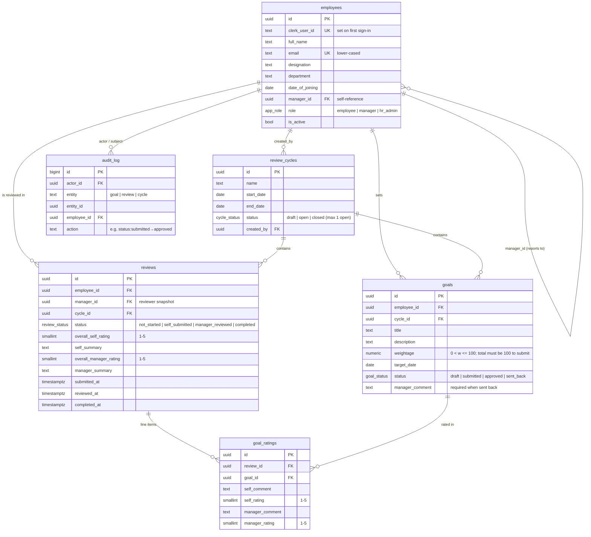
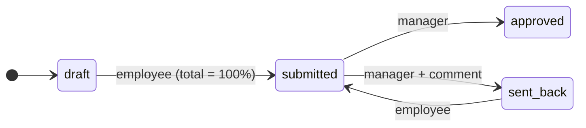
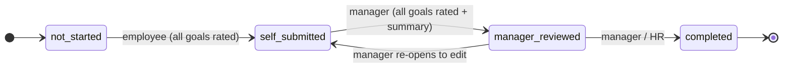

# Data model

Source of truth: [`supabase/schema.sql`](../supabase/schema.sql). GitHub renders the diagram below.

## Foreign keys in one line each

- `employees.manager_id → employees.id` — who you report to; `on delete set null` so removing a manager doesn't delete their team.
- `goals.employee_id → employees.id` — whose goal it is.
- `goals.cycle_id → review_cycles.id` — which cycle the goal belongs to, so years never mix.
- `reviews.employee_id → employees.id` — who is being appraised (unique per cycle).
- `reviews.cycle_id → review_cycles.id` — which cycle this appraisal is for.
- `reviews.manager_id → employees.id` — who reviewed them at the time (survives later manager changes).
- `goal_ratings.review_id → reviews.id` — the review this line item belongs to.
- `goal_ratings.goal_id → goals.id` — the goal being rated (unique per review).

## State machines (enforced by triggers)

**Goal status**

**Review status**

